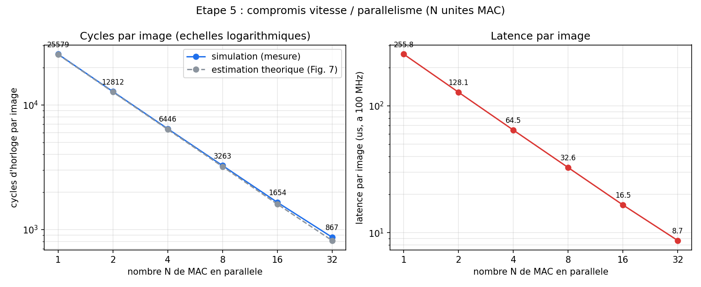

# Accélérateur de réseau de neurones MNIST en VHDL

[](https://github.com/TON-USERNAME/mnist-fpga-vhdl/actions/workflows/ci.yml)

Un réseau de neurones (784 → 32 → 10, MLP quantifié INT8) qui reconnaît les
chiffres manuscrits MNIST, conçu de zéro en VHDL-2008 : du modèle Python de
référence jusqu'à la synthèse FPGA (LUT, mémoires, fréquence max réelle),
en passant par une validation bit-exact sur 1000 images et une exploration
du parallélisme matériel. 100 % simulable sans carte FPGA (GHDL + Yosys +
nextpnr-ecp5, tous gratuits).

> ⚠️ Remplace `TON-USERNAME` ci-dessus (badge CI) par le vrai compte GitHub
> une fois le dépôt poussé, pour que le badge s'affiche correctement.

## But

Montrer, avec des chiffres mesurés (pas des estimations), ce que ça coûte
vraiment de faire tourner un petit réseau de neurones en matériel :
- Un circuit qui **reconnaît un chiffre à 96,60 % de précision**, exactement
  la précision du modèle Python quantifié INT8 (0 écart sur 1000 images, sur
  les 10 scores bruts et pas seulement le chiffre prédit).
- Le **compromis vitesse / surface** du parallélisme spatial : de 1 à 32
  unités MAC en parallèle, et pourquoi la bande passante mémoire — pas le
  nombre de multiplieurs — est le vrai facteur limitant.
- Une **synthèse réelle** (Yosys + place-and-route nextpnr-ecp5) donnant
  LUT, blocs mémoire, multiplieurs matériels et fréquence maximale
  atteignable, avec le chemin critique identifié.

## Schéma

```
                         ┌─────────────────────────────────────────┐
                         │              mlp_top (FSM)               │
pix_data[7:0] ──we,addr─▶│  image_ram   act_ram    weight_rom       │
  (784 pixels)           │  (784×8)     (32×8)     (w1,b1,w2,b2)     │
                         │      │           │            │           │
                         │      └─────┬─────┴──────┬─────┘           │
                         │            ▼             ▼                │
                         │      ┌───────────┐ ┌───────────┐          │
start ──────────────────▶│      │  Couche 1 │ │  Couche 2 │          │
                         │      │ 784 → 32  │▶│  32 → 10  │          │
                         │      │ mac_unit  │ │ mac_unit  │          │
                         │      │ +ReLU+req.│ │ (scores)  │          │
                         │      └───────────┘ └───────────┘          │
                         │                           │               │
                         │                       ┌────▼────┐         │
busy,done ◀──────────────│                       │ argmax  │         │
digit[3:0] ◀──────────────────────────────────────┴─────────┘        │
                         └───────────────────────────────────────────┘
```

Pipeline interne par couche (`controller_fsm`) : pour chaque neurone de
sortie, un unique **MAC pipeliné** (préchargement de l'adresse N+1 pendant
l'application du produit N) parcourt tous les poids d'entrée en 1 cycle par
MAC, suivi d'un cycle ReLU+requantification INT8. `rtl/mac_array.vhd`
généralise ce principe à **N unités MAC en parallèle** (étape 5), partageant
un seul bloc ReLU+requant pour ne pas dupliquer son multiplieur. Schéma
détaillé et chronogramme : [`docs/architecture.md`](docs/architecture.md).

## Résultats

### Précision (étape 4 — `make sim_full`)

| Métrique | Valeur |
|---|---|
| Images testées | 1000 (jeu de test MNIST) |
| Précision matérielle | **966 / 1000 = 96,60 %** |
| Écarts vs modèle Python (10 scores bruts, pas juste le chiffre) | **0** |

Le circuit VHDL reproduit *exactement* l'arithmétique entière du modèle
Python quantifié INT8 — même précision, bit à bit, sur les 10 scores de
sortie de chaque image, pas seulement sur le chiffre final prédit.

### Parallélisme (étape 5 — `scripts/run_sweep.sh`)



| N (MAC parallèles) | Cycles/image | Latence @100 MHz | Écarts vs Python |
|---:|---:|---:|---:|
| 1  | 25 579 | 255,8 µs | 0 |
| 2  | 12 812 | 128,1 µs | 0 |
| 4  | 6 446  | 64,5 µs  | 0 |
| 8  | 3 263  | 32,6 µs  | 0 |
| 16 | 1 654  | 16,5 µs  | 0 |
| 32 | 867    | 8,7 µs   | 0 |

Le gain en cycles suit de près l'estimation théorique `⌈32/N⌉×784 +
⌈10/N⌉×32` (Figure 7 du plan de projet) : chaque doublement de N divise
quasiment par deux la latence. Mesures complètes :
[`results/results.csv`](results/results.csv).

### Synthèse (étape 6 — `make synth` / `make synth_timing`, cible ECP5)

| N (MAC) | LUT4 | Blocs mémoire (DP16KD) | Multiplieurs (MULT18X18D) | Fmax réelle | Tient sur... |
|---:|---:|---:|---:|---:|---|
| **1** (cible officielle) | 1 696 | 14 / 56 (25 %) | 5 / 28 | **50,4 MHz** | LFE5U-25F ✅ |
| 8 | 2 356 | 105 / 108 (97 %) | 19 / 28 | 37,6 MHz | LFE5U-**45F** seulement (ne tient pas sur 25F) |
| 32 | 8 099 | 417 | 67 | — | **ne tient sur aucun modèle ECP5-U** (417 > 208 blocs, même sur le plus gros, le 85F) |

**La leçon principale de ce projet** : le coût du parallélisme spatial n'est
*pas* le nombre de multiplieurs (ça, c'est bon marché — 5 → 19 → 67, ça
tiendrait large). C'est la **bande passante mémoire** : chaque MAC
supplémentaire a besoin de sa propre lecture simultanée de poids, et un bloc
BRAM physique (DP16KD) n'a que 2 ports. Au-delà de 2 voies, le contenu de la
ROM doit être dupliqué dans plusieurs blocs — d'où une consommation mémoire
qui explose bien plus vite que linéairement en N. Résultat concret : N=32,
qui semblait optimal sur le seul critère "cycles par image", est en réalité
**irréalisable** sur cette famille de FPGA. Rapport complet, chemin
critique et méthode de mesure : [`results/synth_report.txt`](results/synth_report.txt).

## Reproduire (en trois commandes)

```bash
git clone https://github.com/TON-USERNAME/mnist-fpga-vhdl.git
cd mnist-fpga-vhdl
make sim_fast   # ~quelques secondes : compile GHDL + simule 50 images
```

Pour la validation complète (1000 images, ~1-2 min) : `make sim_full`.
Pour la synthèse FPGA (nécessite Yosys + yosys-plugin-ghdl + nextpnr-ecp5,
voir [`results/synth_report.txt`](results/synth_report.txt) pour
l'installation) : `make synth` puis `make synth_timing`.

## Arborescence

```
mnist-fpga-vhdl/
├── README.md              vitrine : but, schéma, résultats, reproduction
├── Makefile                make test_units | sim_fast | sim_full | synth | ci
├── python/                 entraînement, quantification INT8, modèle de référence
├── rtl/                    circuit VHDL-2008 (mac_unit, controller_fsm, mlp_top, ...)
├── tb/                     testbenches GHDL
├── data/                   poids quantifiés (.hex) et images de test
├── scripts/run_sweep.sh    balayage du parallélisme N=1..32
├── synth/synth.ys           script de synthèse Yosys (cible ECP5)
├── docs/                   schéma d'architecture, chronogramme
├── results/                results.csv, synth_report.txt, graphiques
└── .github/workflows/ci.yml   tests automatiques (GHDL) à chaque push
```

## Déroulement du projet

Projet mené en 8 étapes, du modèle Python jusqu'à la démo publique :

- [x] **Étape 0-1** — Environnement + modèle Python (MLP 784-32-10, quantification INT8)
- [x] **Étape 2** — Briques VHDL unitaires (MAC, ReLU+requant, argmax)
- [x] **Étape 3** — Mémoires + contrôleur FSM, couche 1 validée (320/320)
- [x] **Étape 4** — Réseau complet validé sur 1000 images (96,60 %, 0 écart)
- [x] **Étape 5** — Exploration du parallélisme (N=1 à 32 MAC)
- [x] **Étape 6** — Synthèse FPGA (Yosys/nextpnr), intégration continue, README ← *tu es ici*
- [ ] **Étape 7** — Démo et publication

## Outils

GHDL (simulation VHDL-2008), Yosys + yosys-plugin-ghdl (synthèse),
nextpnr-ecp5 (placement-routage), Python 3 + NumPy/PyTorch (modèle de
référence), Lattice ECP5 comme famille FPGA cible (choisie pour sa capacité
mémoire : les ~200 kbit de poids ne tiennent pas sur les plus petites
familles iCE40).
